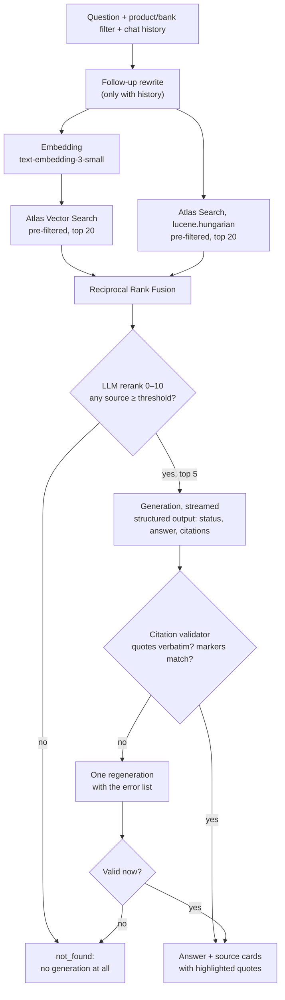

# KB Assistant

An internal RAG assistant demo for Bankmonitor loan experts. An expert asks a question in Hungarian and optionally filters by product and bank. The assistant answers only from the knowledge base and puts a verbatim, code-verified quote behind every claim. When no reliable source exists, it says so instead of guessing.

**Live demo:** https://bankmonitor.vercel.app. The login is shared separately and is never in the repo.

## Architecture



- **Ingestion (local script):** `data/docs/*.md` → front matter validation → section-based chunks with a context header → embeddings → MongoDB Atlas. The script is idempotent and only re-embeds changed documents.
- **One pipeline:** the chat API and the eval script run the same `answerQuestion` generator ([src/lib/pipeline.ts](src/lib/pipeline.ts)), so the eval measures exactly what users see.
- **Streaming:** the answer streams as it is generated. The UI marks the text as unverified until the validated final result replaces it.
- **Access:** every page and API route sits behind a login page with a signed session cookie.

## Accuracy layers

1. **Filtered retrieval.** Product and bank filters are pre-filters inside both searches, so the model never sees text about another product. Hybrid search catches exact terms (THM, bank names, amounts) that vector search misses.
2. **Relevance threshold.** An LLM reranker scores each candidate from 0 to 10. If none reaches `RERANK_THRESHOLD` (6), the system answers "no reliable source" without calling the generation model. The one exception is a message about the assistant itself or small talk ("Mit tudok tőled kérdezni?", "Szia"). For these the reply is a fixed, hand-written help text, never generated.
3. **Strict prompt and structured output.** The model answers only from numbered sources, copies numbers verbatim and recommends no bank. It returns JSON: `status`, `answer` and `citations` (source number and quote). It also sees the active filters.
4. **Citation validator in code.** Every quote must appear verbatim in its cited source (normalised for quote marks, dashes, whitespace and case). Every `[n]` marker needs a citation and every citation needs a marker. The validator does not depend on the model's goodwill.
5. **Retry, then refuse.** A failed answer gets one regeneration with the error list. If that also fails, the user sees the not-found message instead of the unverified text.

## Decisions and trade-offs

| Decision                                                                      | Why                                                                                                                      |
| ----------------------------------------------------------------------------- | ------------------------------------------------------------------------------------------------------------------------ |
| MongoDB Atlas M0 (Frankfurt): Vector Search + Atlas Search `lucene.hungarian` | Free, EU region, reachable from Vercel; vectors, Hungarian full-text and filters in one cluster                          |
| RRF in TypeScript, two parallel queries                                       | Native `$rankFusion` runs its sub-pipelines in sequence, and M0 support is not documented                                |
| LLM rerank (`gpt-5.4-mini`) instead of a cross-encoder                        | No extra vendor; the score doubles as the refusal threshold                                                              |
| `gpt-5.5` with no `temperature`                                               | The GPT-5 family does not support temperature reliably. Determinism comes from the prompt, the schema and the validator. |
| `streamText` / `generateText` + `Output.object`, not `streamObject`           | `streamObject` / `generateObject` are deprecated in the AI SDK                                                           |
| Stream first, validate at the end                                             | Responsive UI; the unverified text is marked and replaced on failure                                                     |
| Chat history in the client, resent with each request                          | No conversation storage is needed for the demo                                                                           |
| Login page with a signed cookie instead of HTTP Basic Auth                    | Public URL and repo with a real OpenAI key. The browser's Basic dialog was confusing and could get stuck in Chrome.      |

The full list, including the decisions that look wrong but are intentional, is in [docs/ARCHITECTURE.md](docs/ARCHITECTURE.md) §06.

## Not in the demo, and how production would do it

- **Number validation:** every number in the answer must appear in a cited source, checked by the validator.
- **Versioning:** documents with validity dates, so expired versions drop out of search and stay in the audit log.
- **Live rates:** interest rates and fees through tool calling from Bankmonitor's product database, with the query date shown. They change too often for documents.
- **SSO and roles:** Microsoft Entra ID, with per-document access in the search filter.
- **Observability:** Langfuse traces for every step (sources, scores, model, cost, latency).
- **Quality:** an LLM-as-judge faithfulness metric next to the automatic ones, a larger golden set built with the experts, and the eval in CI so a regression blocks the deploy.
- **Ingestion at scale:** a background queue, PDF/DOCX parsing that keeps tables intact, and an admin UI for document owners.

## Eval results

`npm run eval` runs the 15-question golden set ([data/golden-set.json](data/golden-set.json)) through the real pipeline. The set has 11 answerable and 4 unanswerable questions, two of them with a bank filter. The latest run is [eval/results.json](eval/results.json), from 2026-10-15 at 10:36 UTC, with `gpt-5.5`, `gpt-5.4-mini`, `text-embedding-3-small` and threshold 6:

| Metric                                                       | Result           | Target |
| ------------------------------------------------------------ | ---------------- | ------ |
| Recall@5: an expected source is among the final sources      | **100%** (11/11) | –      |
| Citation accuracy: cited sources that are expected sources   | **100%** (21/21) | ≥ 98%  |
| Correct refusal: unanswerable questions answered "no source" | **100%** (4/4)   | ≥ 90%  |
| Answer rate: answerable questions actually answered          | **100%** (11/11) | –      |

Two caveats:

- **Small sample.** With 15 questions, one item moves a metric by 6–7 points.
- **Non-deterministic model.** A later run can differ slightly.

## Run locally

You need Node.js 24 (`nvm use`), an OpenAI API key, and a MongoDB Atlas cluster (M0 is enough; it supports the two search indexes).

```bash
npm install
cp .env.example .env.local   # fill in OPENAI_API_KEY, MONGODB_URI, DEMO_USER, DEMO_PASSWORD
npm run db:check             # ping the cluster
npm run db:indexes           # collections, indexes, vector + text search index (waits until queryable)
npm run ingest               # chunk, embed and load data/docs (idempotent)
npm run dev                  # http://localhost:3000, sign in with DEMO_USER / DEMO_PASSWORD
npm test                     # unit tests, no .env.local needed
npm run eval                 # golden set metrics -> eval/results.json (costs OpenAI calls)
```

| Script                                                                                      | What it does                                                  |
| ------------------------------------------------------------------------------------------- | ------------------------------------------------------------- |
| `npm run build` / `npm run start`                                                           | Production build / server                                     |
| `npm run lint` / `npm run typecheck` / `npm run format:check`                               | Quality gates                                                 |
| `npm run search:check`, `rerank:check`, `rewrite:check`, `generate:check`, `pipeline:check` | Live checks of single pipeline steps against Atlas and OpenAI |

## Knowledge base

Fifteen Hungarian documents in [data/docs/](data/docs/) cover mortgages, personal loans, bank accounts and general topics (THM, credit intermediation, KHR); three of them are bank-specific (CIB Bank, MBH Bank, OTP Bank).

- **Source.** Each document summarises public bankmonitor.hu articles in our own words, and its front matter links to the source article and its date.
- **Status.** This is a demo dataset, not Bankmonitor's internal knowledge, and some figures are dated. The documents state the date of each figure.

## Project documents

| What                                                     | Where                                                                |
| -------------------------------------------------------- | -------------------------------------------------------------------- |
| Product scope, features, metrics                         | [docs/PRD.md](docs/PRD.md)                                           |
| Architecture, boundaries, intentional decisions          | [docs/ARCHITECTURE.md](docs/ARCHITECTURE.md)                         |
| Security rules                                           | [docs/SECURITY.md](docs/SECURITY.md)                                 |
| Design tokens and components                             | [docs/DESIGN_SYSTEM.md](docs/DESIGN_SYSTEM.md)                       |
| Task list                                                | [docs/TASKS.md](docs/TASKS.md)                                       |
| Original solution design and task-level plan (Hungarian) | [docs/planning/](docs/planning/)                                     |
| Rules for AI coding agents                               | [AGENTS.md](AGENTS.md), [CLAUDE.md](CLAUDE.md), [.claude/](.claude/) |

Stack: Next.js 16 (App Router) · TypeScript · Tailwind CSS v4 + shadcn/ui · MongoDB Atlas · Vercel AI SDK + OpenAI · Vitest · Vercel (fra1).
